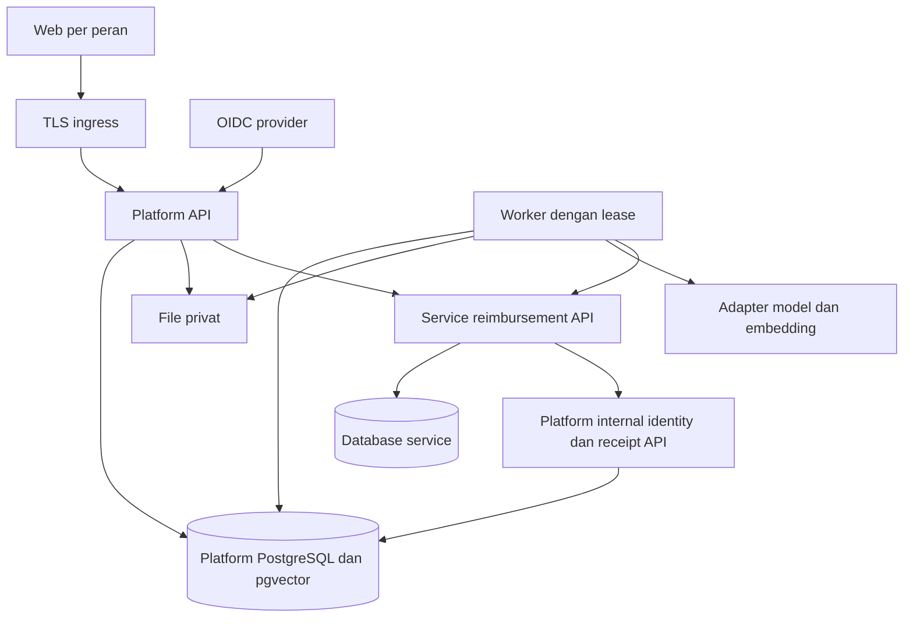

# Architecture — Enterprise AI Agent Platform

Status: rancangan untuk implementasi, bukan bukti runtime. Acuan produk: [PRODUCT_CONTRACT.md](PRODUCT_CONTRACT.md), terutama bagian 3–6. Bentuk API/data dijabarkan pada [DATA_AND_API_CONTRACTS.md](DATA_AND_API_CONTRACTS.md); pembuktiannya pada [TEST_PLAN.md](TEST_PLAN.md).

## 1. Tujuan dan keputusan utama

Platform melayani dua tenant melalui codebase dan orkestrasi yang sama. Checkpoint pertama adalah RAG kebijakan perjalanan ID/EN; MVP mencakup workflow reimbursement sampai keputusan dan status, tanpa pembayaran. Cloud/operasi dan inference open-source merupakan milestone wajib berikutnya.

Backend Python/FastAPI berbentuk modular monolith dengan worker terpisah. Web React/TypeScript menyediakan UI per peran, chat, sumber, pengelolaan dokumen, draf/formulir manual, approval, dan status. LangGraph mengatur state percakapan/tool; service bisnis menentukan state pengajuan. PostgreSQL/pgvector menyimpan data platform dan indeks; file privat melalui adapter object storage. Service referensi memiliki database, credential, API, dan migration sendiri.

Pilihan framework mengikuti kontrak; versi dikunci setelah spike. Neon, provider OIDC/model/embedding, paket AWS, dan inference engine masih kandidat yang harus lolos uji akses, region, kompatibilitas, kualitas, dan biaya. Tidak ada pembelian/provisioning atau klaim biaya yang dilakukan oleh dokumen ini.

## 2. Komponen dan batas kepercayaan

| Komponen | Tanggung jawab | Tidak berwenang |
| --- | --- | --- |
| Browser | Input, ringkasan, konfirmasi/keputusan manusia, polling hasil | Menetapkan identitas, tenant bebas, role, status akhir, atau credential tool |
| API identity/access | OIDC, sesi, CSRF, membership/objek, verifikasi aktor internal | Mengubah identitas berdasarkan prompt |
| Knowledge | Upload, parsing, versi, ACL, chunk/embedding, publish/withdraw | Menjadikan dokumen sumber instruksi sistem |
| Conversations/agent | State berprovenance, klarifikasi, retrieval, tool terbatas, pause/resume | Memberi izin atau menyetujui atas nama manusia |
| Drafts/business configuration | Paket aturan, ringkasan, consent, snapshot, action/outbox | Menetapkan hasil bisnis final tanpa service |
| Worker/integrations | Ingest, model run, dispatch, retry/reconciliation, timeout/budget | Melonggarkan akses saat dependency gagal |
| Service referensi | Perjalanan, klaim, stage/keputusan, aturan dan dedup atomik | Membaca tabel platform atau mempercayai field role/owner/status bebas |
| Audit/evaluation | Metadata tersanitasi, metrik dan runner evaluasi | Menyalin seluruh isi tenant ke trace operator |

Route → service bisnis → repository/provider port. Integrasi SDK/SQL berada pada adapter; satu modul tidak mengubah tabel modul lain melalui jalur tersembunyi. Composition root memasang dependency; konfigurasi/sesi tidak disimpan dalam global mutable state. Pengujian import boundary dan dependency injection mengikuti perubahan modul yang benar-benar dibangun.

## 3. Identitas dan otorisasi

Login OIDC menggunakan authorization code dengan PKCE, state dan nonce yang diverifikasi. Backend memvalidasi issuer/audience/signature/expiry, mengikat pasangan issuer+subject ke principal, dan menerbitkan sesi server-side opaque. Cookie Secure/HttpOnly/SameSite dan proteksi CSRF berlaku untuk mutasi browser, termasuk consent/approval. Redirect URI allowlist; browser tidak menyimpan credential API model/service. Detail provider dan lifetime dikunci pada spike identity sebelum endpoint privat dibangun.

Tenant aktif berasal dari membership terkini. Tenant selector hanya boleh memilih membership sah; perubahan tenant tidak mengadopsi percakapan/run tenant sebelumnya. Role gabungan didukung, tetapi izin tiap tindakan dan objek tetap diperiksa. Revoke sesi atau membership berlaku pada request, tool, resume, dan keluaran berikutnya. Aksi manusia approval/confirmation memerlukan sesi serta nonce/form action terikat versi; pesan chat bukan consent.

Antarservice menggunakan credential layanan yang dapat dirotasi dan konteks delegasi bertanda tangan dengan issuer/audience, tenant, actor, action, object/operation ID, versi/digest, jti dan expiry. Scope credential layanan tidak menggantikan kewenangan manusia. Service memeriksa membership terkini melalui endpoint verifikasi aktor internal platform sebelum mutasi/akses privat; kegagalan verifikasi menahan tindakan. Grant approval terikat aksi manusia dan tidak tersedia bagi tool agent. Endpoint internal hanya menerima caller/scope yang diizinkan; tidak dipublikasikan lewat ingress browser.

Policy pemeriksaan terkini memblokir revocation yang sudah tercatat sebelum pemeriksaan otorisasi final. Operasi yang telah diotorisasi/committed tidak diasumsikan dapat ditarik kembali; audit menyimpan waktu pemeriksaan dan commit. Race revocation diperiksa dalam test plan, termasuk keluaran yang masih tertahan sebelum dikirim.

Bukti aksi manusia memakai catatan immutable human_action_receipt untuk semua confirm/decision. Untuk keputusan, hash dan delegasi mengikat claim, expected_version, revision, stage, decision dan reason persis yang dipilih, selain aktor/sesi/operation ID. Keputusan tidak memerlukan FK draf palsu; action dapat merujuk receipt tanpa draft_id. Perubahan pilihan/alasan/tahap/revision memerlukan aksi dan key baru yang sah, bukan memakai grant/key lama.

## 4. Penyimpanan, isolasi, dan skala

| Penyimpanan | Isi | Aturan |
| --- | --- | --- |
| Platform DB | Membership, ACL, versi, percakapan, draf, consent, jobs, checkpoint, provenance, audit | Tenant-aware FK/index, RLS dan role minimum; blob receipt tidak disalin ke trace |
| Object storage | Dokumen/receipt immutable per versi/digest | Privat, metadata tenant/owner; download proxy API memeriksa akses terkini; tanpa URL publik berumur panjang |
| Service DB | Trip/item, paket aturan, claim/revision/stage, decision, action ledger, item reservations | Credential/schema terpisah; constraint dan transaksi untuk version/idempotency/business dedup |
| Evaluation artifacts | Fixture fiktif, gold, manifest, report tersanitasi | Terpisah dari operasional; akses hasil yang memuat konten mengikuti klasifikasi |

RLS adalah lapisan tambahan, bukan pengganti otorisasi aplikasi. Runtime bukan owner/superuser/BYPASSRLS; role migration terpisah. Tenant/actor context ditetapkan transaction-local. Pool reuse/error/cancellation diuji agar konteks tidak terbawa. Foreign key data tenant menyertakan tenant_id; ID unik tidak menjadi token akses. Operator maintenance memakai jalur scoped dan diaudit, bukan akses isi tenant otomatis.

Adapter checkpoint wajib lulus read/write/list/history/resume/intermediate-write tanpa konteks atau dengan konteks tenant salah, termasuk history dari subgraph. Jika adapter standar tidak memenuhi gate, gunakan wrapper/repository yang menegakkan konteks dan fencing; tidak memberi runtime BYPASSRLS. Checkpoint berisi referensi minimum serta provenance, bukan seluruh file/credential.

API stateless terhadap sesi/run di memory sehingga dapat direplikasi; state durabel berada di database. Worker dapat ditambah terpisah dengan kuota/fair scheduling per tenant, bounded queue, per-tenant model concurrency dan token budget. Cache key mencakup tenant/actor-access revision/source version/config/model, dan hit tetap memeriksa izin. Optimasi indeks/vector/hybrid/rerank mengikuti dataset ID/EN, cardinality ACL, recall dan latency; tidak menghapus filter keamanan untuk mempercepat query.

## 5. Aliran data

### Dokumen dan RAG

1. Upload ke area karantina privat; periksa ukuran/tipe/validitas/keamanan, parsing terisolasi dengan batas resource dan tanpa egress bebas.
2. Worker ingest memakai tenant/version/job generation; parsing dan embedding bertahap idempotent, versi belum terbit tidak masuk retrieval.
3. Indeks siap → publish atomik active version/ACL pointer. Withdraw/revoke menutup akses pada sumber otorisasi lebih dahulu, tanpa menunggu penghapusan indeks/cache.
4. Pertanyaan terikat conversation owner → retrieval vector atau hybrid dengan filter tenant/ACL/status/version → verifikasi sumber → konteks minimum → model → verifikasi provenance/akses/citation → keluaran buffered yang sah.
5. Jawaban memuat sumber/versi/lokasi, atau klarifikasi/abstain/konflik. Riwayat yang bergantung sumber dicabut disaring/disembunyikan saat dibaca; penggunaan ulang checkpoint membangun konteks baru dari izin terkini.

Tidak ada streaming token sensitif sebelum pemeriksaan akhir. Pembaruan sumber tidak memalsukan kutipan lama: riwayat sah menandai versi lama sudah diganti. Embedding model/dimension/version tercatat; migrasi embedding menyiapkan indeks baru dan evaluasi sebelum switch, tidak mencampur vector tidak kompatibel.

Provenance mencakup resource bertipe document/trip/claim/receipt dan output tool, dengan source_system, resource/version, actor-scope dan pemeriksaan akses yang relevan. Ownership percakapan tidak memberi akses abadi atas ringkasan finansial. Perpindahan stage yang menghilangkan hak reviewer memicu penyaringan data turunan pada history/cache/checkpoint/resume dan sebelum keluaran, walau membership tidak berubah. Service access-check memverifikasi resource terkini; saat verifikasi gagal, bagian tersebut ditahan/disaring.

### Aturan dan submission

Paket dokumen+aturan immutable diperiksa pemilik proses → service menerima dan mengakui digest → platform mengaktifkan rentang berlaku yang tidak overlap. Untuk perjalanan lama, paket ditentukan oleh tanggal selesai perjalanan di timezone tenant. Paket ditarik/konflik menahan submission; paket terkunci pada claim tetap tersedia untuk audit. Tidak ada perubahan retroaktif/rerouting aktif dalam MVP.

Konten paket immutable dipisahkan dari operational eligibility yang versioned pada platform. Service memanggil endpoint internal policy-eligibility sebelum submission, pelengkapan, dan keputusan, termasuk untuk paket yang dikunci pada claim. Paket superseded dapat tetap sah untuk claim terkunci; withdrawn/known-conflict memblokir mutasi tersebut. Ack digest atau salinan status service bukan bukti izin terkini. Verifikasi tidak tersedia berarti hold. Audit mencatat eligibility revision dan waktu pemeriksaan; withdrawal yang tercatat sebelum pemeriksaan final menolak request lama yang kemudian tiba. Tidak perlu callback ke service dari endpoint eligibility platform.

Draf editable → ringkasan versioned → konfirmasi manusia → satu transaksi platform membekukan snapshot+consent+operation+outbox. Worker memeriksa izin dan paket, lalu mengirim payload/key yang sama ke service. Service memverifikasi delegasi, aturan, receipt, deadline saat penerimaan, dan item reservations; claim/revisions/route/action result/audit dicatat atomik. Konfirmasi sebelum deadline tidak menjamin antrean diterima tepat waktu; UI menampilkan fakta ini.

Draf beku tidak diedit selama queued/sending/unknown. Respons hilang → lookup action, bukan key baru. Respons not-found saja belum membuktikan request lama tidak akan commit: gunakan prosedur seal-if-absent yang atomik pada service. Service membuat tombstone penolakan bila action belum commit, atau mengembalikan hasil yang sudah commit. Worker/attempt lama tidak boleh mengirim action sealed. Baru setelah terminal no-commit dan fencing durabel, koreksi menghasilkan draf/consent/action baru. Perubahan aturan/izin tidak mengubah payload action lama.

### Receipt lintas service

Service meminta metadata tepercaya dan pin receipt melalui API internal platform dengan operation/candidate claim ID; platform memverifikasi tenant, owner, versi/digest, scan-ready dan snapshot consent. Pin idempotent menjaga file tidak dihapus saat commit/reconciliation. Metadata endpoint tidak memanggil service balik sehingga tidak membuat siklus otorisasi.

Setelah commit, receipt terikat claim dan retention. Pin orphan dilepas hanya setelah lookup/seal membuktikan no-commit; bukan timeout saja. Download melalui platform meminta hubungan aktor–claim terkini ke service, lalu memeriksa file/tenant/retention lokal. Caller yang tidak dapat diverifikasi atau service tidak tersedia mendapat penolakan sementara, bukan akses berdasarkan role approver umum.

### Approval dan resume

Keputusan manusia berjalan lewat API → delegasi aksi/version → service memeriksa scope stage, identitas bukan pemohon, versi dan status → keputusan atomik. Tahap berikutnya hanya dibuka setelah tahap kini sah. Needs-information membuka alur revisi+konfirmasi baru yang memulai ulang approval dengan paket aturan terkunci. Terminal approved/rejected tidak dibuka ulang dan bukan pembayaran.

Polling membaca status service. Agent run tidak memegang request/koneksi DB selama menunggu manusia; checkpoint memakai referensi claim. Resume memverifikasi aktor, versi run, izin sumber dan hasil service terkini sebelum eksekusi.

## 6. Worker, transaksi, dan failure handling

Tabel jobs/outbox mendukung claim atomik, lease_until, generation monotonik, heartbeat, next_attempt_at dan retry budget. Satu run memiliki satu writer; semua writes checkpoint/intermediate/history pointer/publication/job completion memakai generation/version sah. Worker usang tidak dapat commit state setelah lease hilang. Panggilan eksternal yang sudah terbang tetap dilindungi action key+snapshot; service business dedup menangani key berbeda untuk item sama.

At-least-once dispatch tidak disebut exactly-once jaringan. Kepastian satu hasil bisnis berasal dari ledger idempotency dan constraint/transaksi service. Query hasil kembali memeriksa izin. Key dipertahankan setidaknya selama claim/action dan jendela restore terkait masih dipertahankan; penghapusan memerlukan prosedur aman, bukan recycle otomatis.

Retry hanya error sementara dengan backoff/jitter/budget. 4xx akses/aturan tidak diulang membabi buta; timeout commit → unknown/reconcile; model unavailable → pesan layanan dan draf tetap tersimpan; file/identity verifier unavailable → fail closed. Dead job ditahan dengan alasan dan jalur operator terotorisasi, tanpa tombol yang melewati consent atau membuat key baru diam-diam. Budget langkah/token/ukuran/timeouts diatur server, bukan prompt tenant.

## 7. Deployment, keamanan cloud, dan recovery

Pengembangan menjalankan dependency minimum, fixtures fiktif, dan service referensi terpisah. M1/M2 memiliki environment penerimaan tercatat dan model/service integration nyata; cluster/GPU harian tidak wajib. Build Docker locked dan migration terkontrol dipakai sebelum environment cloud diperluas.

Milestone 3 diarahkan AWS: TLS ingress publik untuk web/API; worker, service internal dan database tidak dibuka ke internet umum. Security group/network policy/egress allowlist membatasi jalur; model/OIDC/storage keluar melalui TLS. IAM workload minimum, encryption at rest/in transit, secret manager atau secret injection aman, dan rotasi dipakai sesuai platform yang dipilih. Tidak menyimpan secret di Git/image/trace. Region dan jalur transfer model/embedding/log/backup disetujui sebelum data sensitif.

Kandidat compute EC2/K3s atau alternatif diputuskan lewat kapasitas, biaya dan akses akun. Database managed dan S3 dipilih berdasarkan backup/region/latency. Container menjalankan API, worker dan service dengan resource limits dan user non-root; parser dibatasi terpisah. Readiness memeriksa dependency minimum; liveness tidak memicu restart storm karena dependency eksternal padam. Graceful shutdown menghentikan claim baru dan membiarkan lease/idempotency menangani in-flight. Migration satu runner, backward-compatible expand/contract, diuji pada data lama; rollback aplikasi tidak dianggap rollback database otomatis.

CI memeriksa format/schema, unit, integrasi dan critical regression dengan credential scoped, lalu build artifact immutable, scan dependency/image, dan deploy dengan gate. Acceptance relevan diulang pada deployment final; rollout/rollback dan restore benar-benar diuji. Kubernetes membuktikan probes, replika, limits, rollout/rollback dan restart; satu node bukan HA lintas mesin. Pemisahan failure domain/HA lebih luas hanya diklaim setelah target dan deploymentnya diuji.

Backups mencakup platform DB, service DB/action ledger, file versions, config dan deletion/revocation journal. Restore diisolasi, outbound/worker ditahan, rekonsiliasi backup berbeda waktu dengan action service/file/paket, lalu replay deletion/revocation. Tidak membuka akses sebelum referensi dan policy konsisten. Unknown tetap ditahan; tidak menebak no-commit. Uji restore mempertahankan tombstone/key dan pin agar side effect lama tidak terulang. RPO/RTO ditetapkan dan diukur pada milestone 3 sebelum acceptance, bukan klaim tanpa angka.

Security recovery journal disimpan append-only di failure domain terpisah dari snapshot DB yang dipulihkan, dengan sequence monotonik per tenant, integrity metadata dan latest complete watermark dari sumber durabel independen. Sebelum revoke/delete/perubahan akses resource dinyatakan berhasil, tulis deny/delete intent ke journal independen, lalu commit perubahan lokal dan hasil intent. Jika hasil lokal belum pasti, replay intent tetap menutup akses secara konservatif. Recovery mengambil perubahan sesudah watermark snapshot sampai watermark terkini yang dapat diverifikasi; bukan memakai journal tua dari backup yang sama. Scope dengan gap/journal hilang tidak dibuka. Rotasi sesi pascarestore, perubahan akses tahap claim, dan package withdrawal masuk cakupan safety journal. Ini gate keamanan pembukaan layanan, bukan janji zero-RPO untuk seluruh transaksi bisnis.

## 8. Model, kualitas, biaya, dan privacy

Adapter chat/tool, embedding, dan opsional reranker memiliki kontrak output, timeout, rate limit, token dan cost recording. Hanya tool allowlist dengan payload schema; model tidak mendapatkan SQL bebas, shell, URL bebas, atau approval tool. Circuit breaker/model fallback tidak melonggarkan akses/aturan; mutasi tidak di-replay melalui provider lain tanpa state action sama. Satu commercial provider pada MVP, model routing multi-provider belum diwajibkan.

Milestone 4 membandingkan deployment open-source nyata (kandidat Llama/Qwen/Mistral, inference engine kandidat vLLM/Hugging Face) dengan commercial baseline. Pilih melalui dukungan tool/ID/EN, license, resource/GPU, quality/safety, latency dan total cost; kuantisasi/batching dicoba bila relevan. Resource dan basis harga dicatat pada saat eksperimen. Fine-tuning memerlukan gap yang terukur dan data train/validation/test terpisah; prompting/RAG/aturan konvensional dievaluasi lebih dahulu. Private hosting bukan jaminan privacy; egress/telemetry/akses/log ikut diperiksa.

Trace default berupa metadata action, correlation, source IDs/version, usage, duration dan error tersanitasi; isi sensitif hanya melalui akses diagnostik eksplisit yang diaudit. Retensi/penghapusan mengikuti matriks data dan harus dilengkapi sebelum data sensitif digunakan. Logging, policy akses, incident procedure dan restore evidence mendukung pembahasan kebutuhan keamanan klien; dokumen ini tidak mengklaim sertifikasi ISO/SOC atau kepatuhan hukum.

## 9. Traceability tujuh bidang dan delivery

| Bidang lowongan | Lokasi desain | Pembuktian pada TEST_PLAN |
| --- | --- | --- |
| Enterprise architecture/engineering | §2–4, 6–7: modular, tenant, scale, constraints, budget | ARC-01, SEC-01–05, PERF-01, OPS-01–04 |
| Agent/workflow | §3, 5–6: context, tools, consent, stage, API, recovery | WF-01–08, JOB-01–02 |
| LLM/open-source | §8: commercial adapter, open-source/customisation/inference tradeoff | MODEL-01–03 |
| RAG/document intelligence | §4–5: extraction PDF teks, vector/hybrid, ACL, lifecycle | RAG-01–06, DOC-01–03 |
| Cloud/security | §3–4, 7–8: identity, network, IAM, retention, restore | SEC-01–08, OPS-01–04 |
| Quality/cost | §6, 8: budgets, traces, failures, evaluasi | EVAL-01–02, PERF-01–02, UX-01 |
| Leadership/delivery | §9: review, keputusan, bukti dan ownership | DEL-01–02 |

Implementasi mengikuti dependency PRODUCT_CONTRACT §6: kontrak/spike → identity/data → knowledge/jobs → RAG+web M1 → service+rules → workflow+approval web → M2 acceptance → cloud M3 → inference M4. Service dapat disiapkan setelah identity/API contract siap; frontend dikerjakan per alur. Setelah tiap tahap: review diff, checks relevan, temuan diperbaiki, bukti tersanitasi dan dokumentasi aktual diperbarui. Pengguna mendapat checkpoint menjelaskan, menjalankan, dan mencoba recovery sendiri.

Gate dibedakan: sebelum fitur privat dibangun, invariant/trust boundary/API access dan batas resource awal harus jelas; spike/prototype memakai nilai sementara aman dan data fiktif untuk kalibrasi; sebelum acceptance, workload/manifest/ambang final dibekukan. Estimasi benchmark tidak memblokir prototype yang diperlukan untuk mengukurnya.

Scope tidak diperluas ke voice, OCR, tender analysis, marketplace, pembayaran atau semua CRM/ERP. Pemetaan lowongan menunjukkan kemampuan yang dibuktikan per tahap, bukan kewajiban memakai seluruh vendor atau bukti pengalaman profesional bertahun-tahun.

Referensi teknis primer: [PostgreSQL row security](https://www.postgresql.org/docs/current/ddl-rowsecurity.html) menjelaskan pengecualian owner/BYPASSRLS; [LangGraph persistence](https://docs.langchain.com/oss/python/langgraph/persistence) menyediakan state checkpoint, bukan otorisasi aplikasi; [AWS Well-Architected](https://docs.aws.amazon.com/wellarchitected/latest/framework/welcome.html) menjadi kerangka tradeoff operasi, security, reliability, performance, dan biaya. Konfigurasi aktual tetap memerlukan uji.
