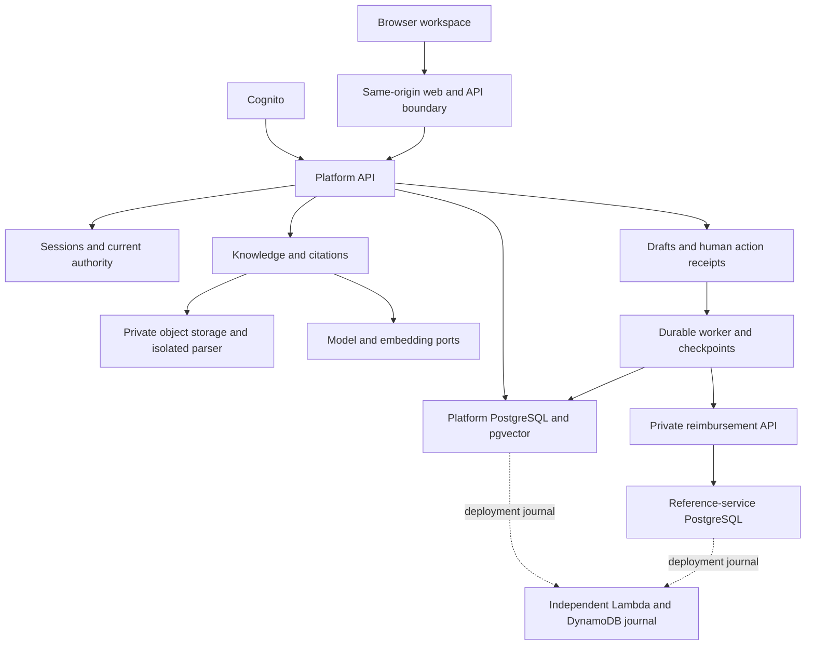

# System architecture

Enterprise AI Agent Platform separates knowledge assistance, human authorization, durable
orchestration, and authoritative business state.

## Component responsibilities

| Component | Responsibility |
| --- | --- |
| React workspace | Conversations, sources, drafts, approvals, and scoped administration. |
| Platform API | Identity, current authority, request boundaries, module coordination, and browser contracts. |
| Platform worker | Durable jobs, document processing, assisted execution, dispatch, and reconciliation. |
| PostgreSQL/pgvector | Tenant-scoped state, retrieval indexes, operation records, and checkpoints. |
| Reference service | Trips, immutable rule packages, claim revisions, approval stages, and business receipts. |
| Model adapters | Typed retrieval/assistance inputs and outputs, under explicit provider configuration. |
| Deployment package | Containers, routing, infrastructure definitions, journal wiring, and operator recovery. |

## Trust boundaries

The browser supplies user intent; the backend derives tenant, identity, and current authority.
Prompts, model output, and tenant configuration cannot grant content access or authorize a claim.
Opaque sessions and CSRF controls protect browser mutations. PostgreSQL RLS adds tenant isolation
beneath application authorization.

Document reads and conversation history are checked against current source access. Withdrawal,
membership changes, and session revocation remain relevant after a conversation was created.
Human consent is bound to the reviewed draft and policy version. Changes require another review.

Platform and reference service use separate credentials and migration histories. Signed internal
calls and source-derived authority bind business operations to the originating actor and action.
The reference service enforces its own business state transitions.

## Recovery

Workers use leases and fencing to avoid stale execution. An operation identity survives retry;
an uncertain external result is reconciled through authoritative lookup rather than a new action.
LangGraph checkpoints persist assisted progress while the human review remains explicit.

The cloud package includes independent journal and held-restore/replay procedures. Those
definitions are deployment preparation; operational acceptance belongs to the configured target.
See the [operator runbook](deployment/README.md).

## Implementation map

- [Backend module boundaries](docs/backend/architecture.md)
- [Database ownership](docs/backend/database_schema.md)
- [Data and API contracts](DATA_AND_API_CONTRACTS.md)
- [Repository layout](docs/REPOSITORY_LAYOUT.md)
- [Security policy](SECURITY.md)
