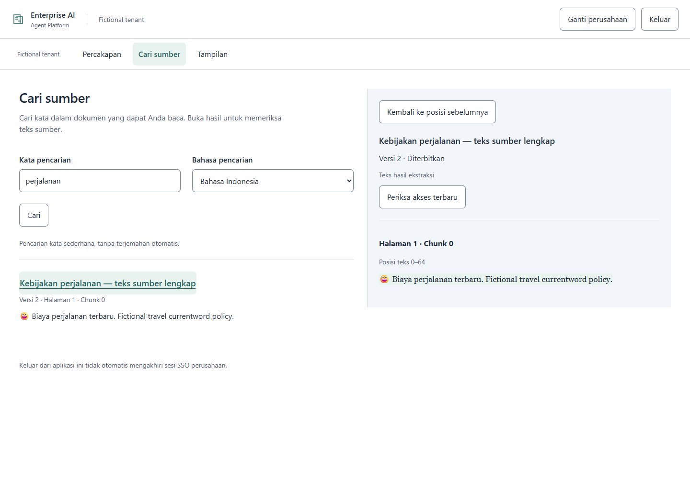
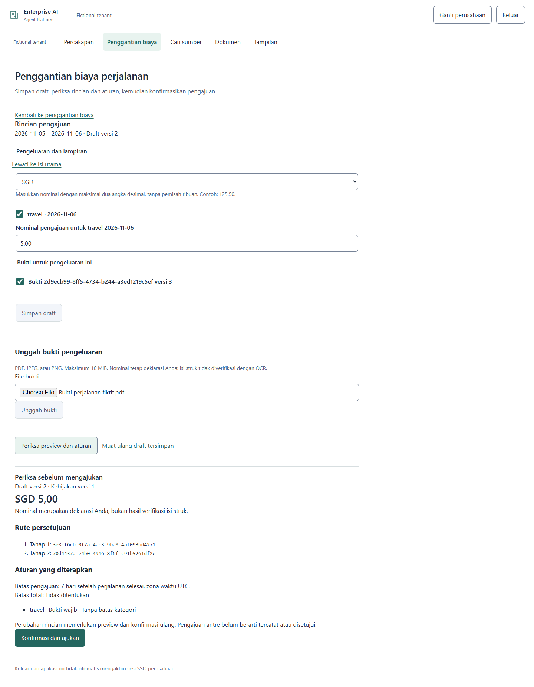
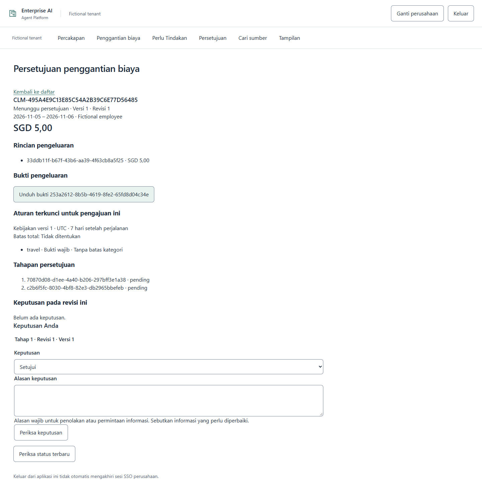
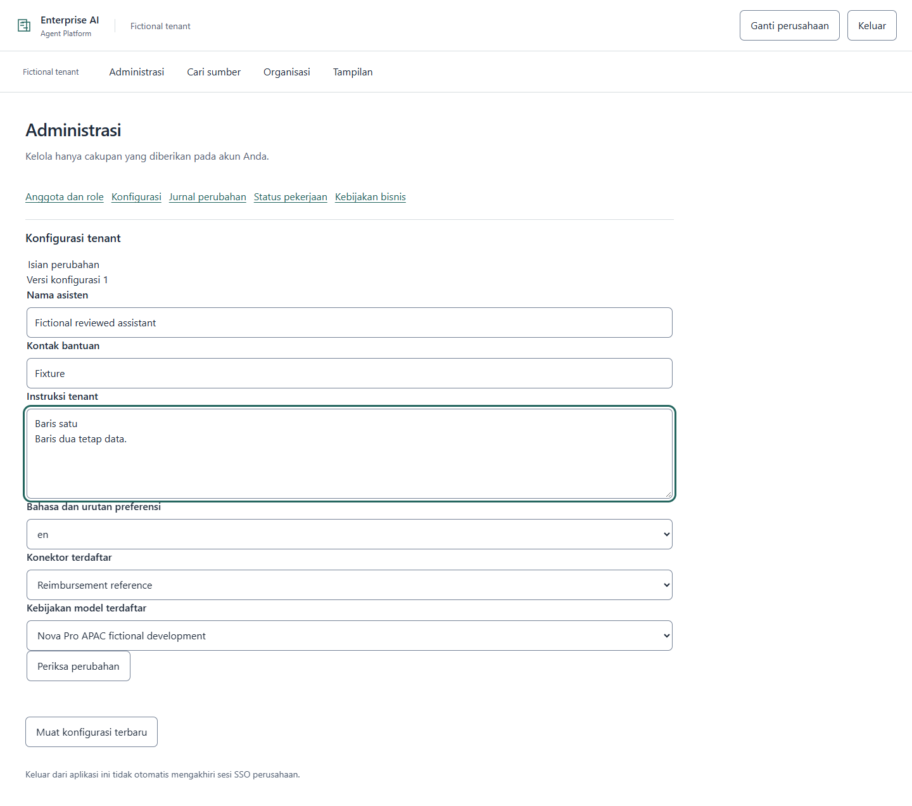
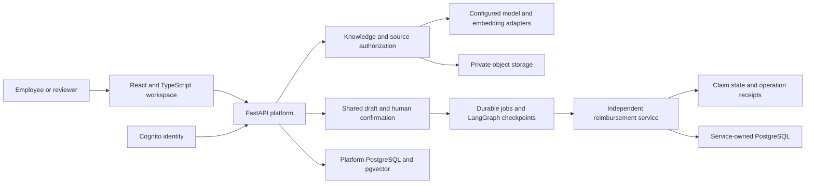

# Enterprise AI Agent Platform

A multi-tenant workspace that connects company knowledge to human-approved business workflows.

Employees can ask policy questions, inspect the supporting sources, prepare travel reimbursements,
and follow an application through review. Knowledge managers control document publication and
audiences; reviewers act on the exact submission in front of them. AI assistance works within
server-enforced identity, policy, and transaction boundaries.

> Find the policy. Review the evidence. Confirm the action.

[](docs/product-tour/README.md)

[Product tour](docs/product-tour/README.md) · [Engineering case study](docs/portfolio/CASE_STUDY.md) · [Architecture](ARCHITECTURE.md) · [Local setup](docs/GETTING_STARTED.md)

## Why it exists

Company knowledge and operational workflows often live apart. An employee can find a travel
policy but still needs to understand the applicable version, gather receipts, prepare a claim,
and reach the correct approver. An AI answer becomes useful when that entire path stays
inspectable and under the right person's control.

This project brings policy retrieval, document governance, reimbursement preparation, approval,
and recovery into a shared application foundation.

## Product workflow

```text
Company workspace → Policy question → Inspect cited sources
                  → Prepare reimbursement → Review and confirm
                  → Approval → Submission status and receipt
```

| Workspace | What users can do |
| --- | --- |
| Conversations | Ask in Indonesian or English, revisit owned conversations, and open cited passages. |
| Knowledge | Upload documents, inspect extracted text, publish versions, set audiences, and withdraw content. |
| Reimbursements | Prepare a claim manually or with AI assistance, attach receipts, and review applicable rules. |
| Approvals | Inspect the submission and evidence, approve, reject, or request information within current authority. |
| Administration | Manage scoped membership, configuration, business policies, and operational status. |

## Product tour

<table>
  <tr>
    <td width="50%"><a href="docs/product-tour/source-search.png"></a><br><strong>Inspect the source</strong><br>Read the policy passage alongside search results.</td>
    <td width="50%"><a href="docs/product-tour/reimbursement.png"></a><br><strong>Review before submitting</strong><br>Check expenses, attachments, rules, and the approval route.</td>
  </tr>
  <tr>
    <td width="50%"><a href="docs/product-tour/approval.png"></a><br><strong>Keep decisions human</strong><br>Review the exact claim and record an authorized decision.</td>
    <td width="50%"><a href="docs/product-tour/administration.png"></a><br><strong>Govern each workspace</strong><br>Manage configuration through scoped administrative controls.</td>
  </tr>
</table>

These are application captures using fictional local fixtures. The [tour](docs/product-tour/README.md)
explains each view. They illustrate the interface rather than a public hosted deployment.

## Engineering highlights

- **Tenant and session boundaries:** Cognito-backed identity, opaque server-side sessions, CSRF
  protection, current-authority checks, and PostgreSQL row-level security.
- **Governed retrieval:** versioned documents, audience-aware retrieval, source citations, and
  renewed access checks when content is read.
- **Explicit human consent:** manual and assisted preparation converge on a shared draft and
  review flow; confirmation is bound to the reviewed version.
- **Durable execution:** job leases, idempotent operation identity, checkpointed workflows, and
  receipt lookup support recovery without blindly repeating a consequential action.
- **Independent business enforcement:** a separately packaged reimbursement service owns claim
  state, approval stages, its database authority, and transaction outcomes.
- **Data lifecycle controls:** policy-bound inventory, retention checks, conversation erasure,
  and private export are implemented behind explicit configuration.
- **Operational preparation:** container definitions, AWS infrastructure templates, private
  service routing, security-journal integration, and operator recovery runbooks are included.

## Architecture



The platform is a modular Python application shared by API and worker processes. The
reimbursement service has independent packaging, credentials, and migrations. Model output
supplies assistance; application and service controls authorize actions.

**Stack:** React, TypeScript, Vite, FastAPI, Python, LangGraph, PostgreSQL/pgvector, Cognito,
private S3 storage, and configurable model adapters. The AWS deployment package targets EKS
with an independent Lambda/DynamoDB security journal.

## Explore locally

Start with the [local setup guide](docs/GETTING_STARTED.md). The default configuration supports
API bootstrap and a public frontend shell without paid model credentials. Authenticated business
flows use explicitly configured identity, storage, databases, and the reference service.

```powershell
git clone https://github.com/williamlo90/enterprise-ai-agent-platform.git
cd enterprise-ai-agent-platform
python -m uv sync --locked --project backend
python -m uv run --locked --project backend enterprise-ai-api --env-file .env.example
```

Development API documentation is served at `http://127.0.0.1:8000/docs`.
See the [frontend guide](frontend/README.md) for the browser workspace.

## Project scope

The knowledge, reimbursement, approval, and administration workflows have been integrated and
accepted locally. Cloud deployment and model-quality acceptance are separate operator activities;
the [deployment package](deployment/README.md) contains the implementation and runbook for those
steps. The reference service is built for this project. Reimbursement payments and commercial ERP
integration are outside the product scope.

## Documentation

| Start here | Purpose |
| --- | --- |
| [Documentation index](docs/README.md) | Product, architecture, setup, security, and operations. |
| [Engineering case study](docs/portfolio/CASE_STUDY.md) | Product reasoning and engineering decisions. |
| [Application pack](docs/portfolio/APPLICATION_PACK.md) | Portfolio description, CV bullets, and interview talking points. |
| [Product contract](PRODUCT_CONTRACT.md) | Users, responsibilities, and workflow boundaries. |
| [Data and API contracts](DATA_AND_API_CONTRACTS.md) | Ownership, authorization, and transaction semantics. |
| [Security policy](SECURITY.md) | Trust boundaries and private vulnerability reporting. |
| [Verification guide](TEST_PLAN.md) | Verification approach and explicit integration opt-ins. |
| [Deployment runbook](deployment/README.md) | Operator configuration, release, and recovery. |

## Source use

Copyright (c) 2026 williamlo90. All rights reserved. This repository is available for portfolio
review under the [source-use notice](LICENSE). Third-party components retain their own licenses;
frontend attribution is recorded in [third-party notices](frontend/THIRD_PARTY_NOTICES.md).
