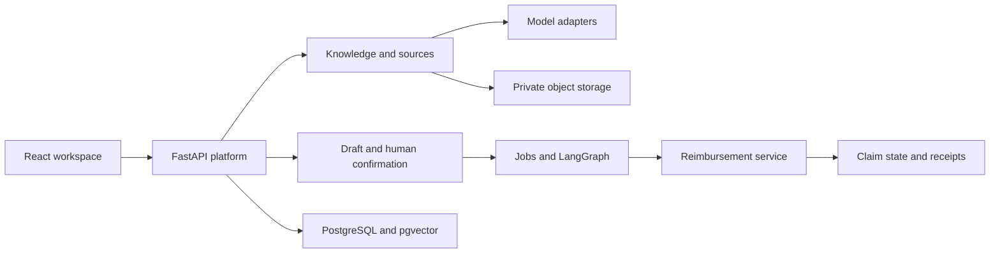

# Enterprise AI Agent Platform

Company knowledge, reimbursement, and approvals in an AI-assisted workspace.

Ask a policy question, open the source, prepare a reimbursement, and follow it through review.
The platform brings these steps together with separate company workspaces, document controls,
and explicit human approval.


[Product tour](docs/product-tour/README.md) | [Architecture](ARCHITECTURE.md) | [Case study](docs/portfolio/CASE_STUDY.md) | [Getting started](docs/GETTING_STARTED.md)

## What it does

| Area | Capabilities |
| --- | --- |
| Knowledge assistant | Indonesian and English conversations, cited answers, and source inspection. |
| Document management | Upload, text preview, versioning, publication, audience rules, and withdrawal. |
| Reimbursement | Manual or assisted preparation, receipt attachments, policy review, and confirmation. |
| Approvals | Assigned reviews, approval, rejection, requests for information, and status tracking. |
| Administration | Company membership, roles, configuration, and business policies. |

## From a question to an action

```text
Ask about policy -> Inspect the source -> Prepare a draft
                -> Review and confirm -> Approval -> Track the result
```

Employees can start from a conversation or prepare a reimbursement directly. Both paths use
the same editable draft and review form. The user checks the details and confirms before
the platform submits an action.


## How it is built

The frontend uses React and TypeScript. A FastAPI backend coordinates identity, knowledge,
conversations, drafts, and background work. PostgreSQL and pgvector hold application state
and retrieval indexes; LangGraph checkpoints preserve assisted workflow progress.

A separate reimbursement service owns claim state, business rules, approval stages, and
operation receipts. Model adapters provide assistance within application-controlled permissions.



## Engineering decisions

- **Current access checks:** sessions, company membership, and source permissions are checked
  when protected content or actions are requested.
- **Version-bound review:** confirmation applies to the draft and rules the user reviewed.
- **Recoverable execution:** stable operation keys, job leases, checkpoints, and receipt lookup
  help recover interrupted workflows.
- **Independent business rules:** the reimbursement service enforces its own authorization
  and commits business effects with their receipts.
- **Data lifecycle controls:** policy-bound inventory, conversation erasure, and private export
  are available through explicit configuration.

The [case study](docs/portfolio/CASE_STUDY.md) explains these decisions. Container definitions,
AWS infrastructure templates, and release/recovery procedures are in the [deployment guide](deployment/README.md).

## Run locally

Requirements and frontend setup are in [Getting started](docs/GETTING_STARTED.md).
From the repository root:

```powershell
python -m uv sync --locked --project backend
python -m uv run --locked --project backend enterprise-ai-api --env-file .env.example
```

Open `http://127.0.0.1:8000/docs` for the development API. See the
[frontend guide](frontend/README.md) for the browser workspace and configuration.

## Repository guide

| Location | Contents |
| --- | --- |
| [frontend](frontend/) | React workspace and browser components. |
| [backend](backend/) | Platform API, modules, workers, and migrations. |
| [reference_service](reference_service/) | Independent reimbursement service. |
| [deployment](deployment/) | Containers, routing, release, and recovery tools. |
| [infra](infra/) | AWS infrastructure and security-journal definitions. |
| [docs](docs/README.md) | Product, architecture, setup, and portfolio documentation. |

[Product contract](PRODUCT_CONTRACT.md) | [Data and API contracts](DATA_AND_API_CONTRACTS.md) | [Security](SECURITY.md) | [Verification](TEST_PLAN.md) | [Application pack](docs/portfolio/APPLICATION_PACK.md)

## Source use

Copyright (c) 2026 williamlo90. All rights reserved. Available for portfolio review under the
[source-use notice](LICENSE). Third-party attribution is preserved in
[frontend notices](frontend/THIRD_PARTY_NOTICES.md).
