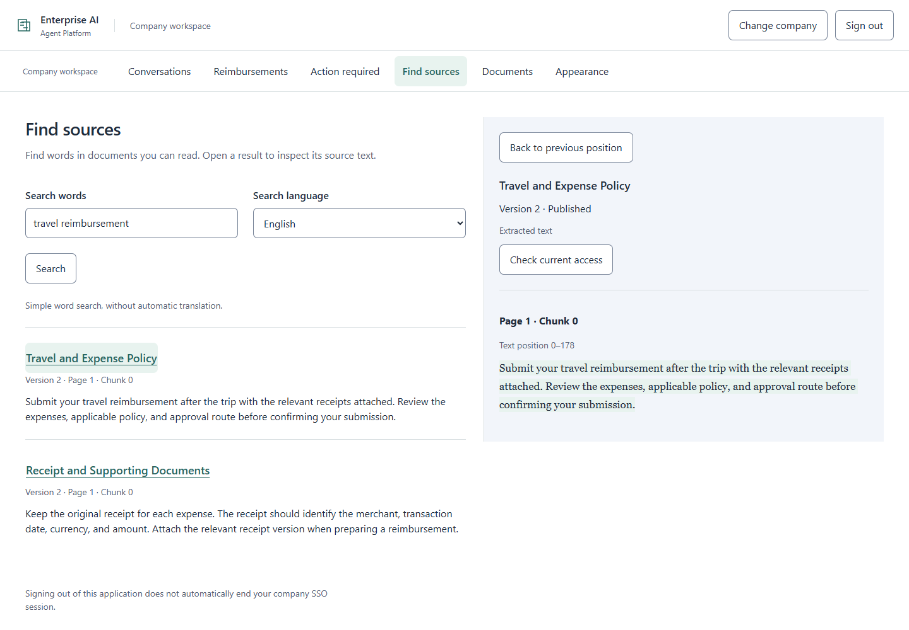

# Enterprise AI Agent Platform — engineering case study

## Product problem

Employees need more than an answer about company policy. They need to inspect the applicable
source, prepare an accurate request, attach evidence, and reach the right approver. Companies
need the same workflow to respect tenant boundaries, changing permissions, and versioned rules.

Enterprise AI Agent Platform connects knowledge assistance to that operational path. The initial
business domain is travel-policy guidance and reimbursement, implemented through a reusable
platform and an independently enforced reference business service.

## What was built

A bilingual React workspace brings together conversations, source inspection, document
publication and audience controls, manual and assisted reimbursement preparation, approval,
and scoped administration. A FastAPI platform coordinates identity, knowledge, drafts,
consent, jobs, and checkpoints. PostgreSQL/pgvector supplies transactional persistence and
retrieval. A separate service owns the business state and operation receipts.

See the [product tour](../product-tour/README.md) for the application screens.

## Decisions that shape the system

### AI helps prepare; people authorize

Manual and assisted flows converge on the same editable draft and preview. The user reviews
expenses, receipt versions, policy, and approval route before consent is recorded. Model output
cannot submit a claim or manufacture a reviewer decision. Changes invalidate stale review.

### Access is current, not remembered

The platform derives authority from server-owned membership and session state. Document
withdrawal or changed audience rules can affect old citations and conversation history.
Content is checked when read, keeping a previous answer from becoming a permanent access grant.

### Business truth belongs to the owning service

The reimbursement service has independent packaging, credentials, migration history, and
transaction boundaries. It verifies internal context and current business authority. Its claim
effects and operation receipts commit together, so the platform cannot declare success solely
because it sent a request.

### Unknown outcomes deserve an explicit state

A network failure can happen after a business operation commits. Stable action identity,
durable dispatch, fenced leases, and receipt lookup preserve the distinction between an
acknowledged job, a known result, and an unresolved outcome. Recovery seeks the original result
before attempting another effect.

### Privacy and operations use explicit authority

Conversation inventory, retention, erasure, and private export use policy-bound owning-store
controls. The deployment package adds independent journaling and held recovery procedures.
Operators configure and activate these capabilities for their target environment.

## Engineering structure

The platform keeps domain and ports independent of FastAPI, provider SDKs, and SQL adapters.
Composition wires API and worker resources. LangGraph checkpoints preserve assisted progress;
durable jobs coordinate background work. The reference service remains a separate trust boundary.

See the [system architecture](../../ARCHITECTURE.md), [backend guide](../backend/architecture.md),
and [data contracts](../../DATA_AND_API_CONTRACTS.md) for implementation detail.

## Portfolio positioning

This project demonstrates full-stack AI product engineering across retrieval, identity,
human review, durable orchestration, transaction correctness, privacy, and operational tooling.
The repository includes the application, independent business service, infrastructure templates,
and release/recovery tooling.

Use the [application pack](APPLICATION_PACK.md) for concise professional descriptions.
