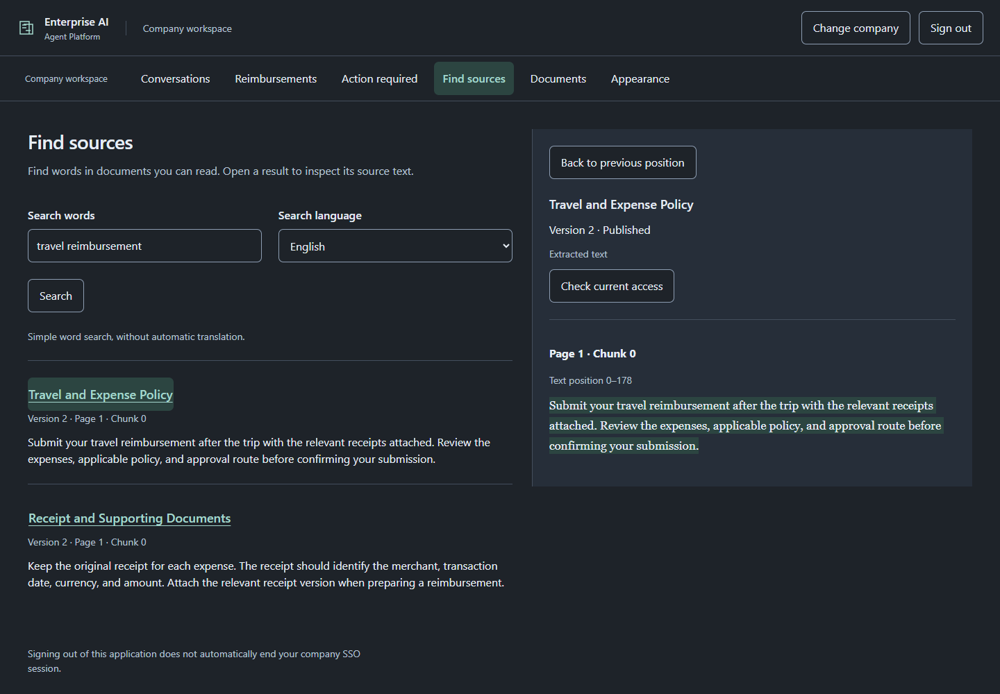
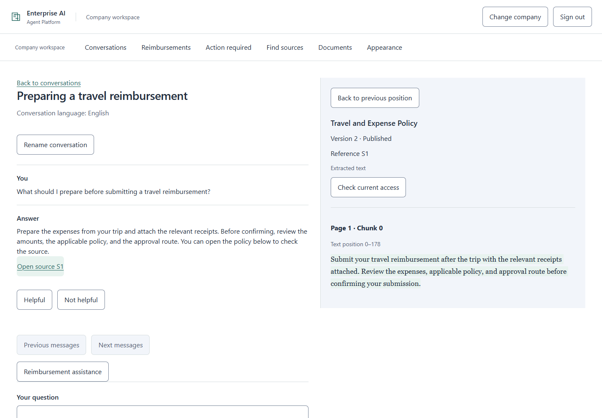
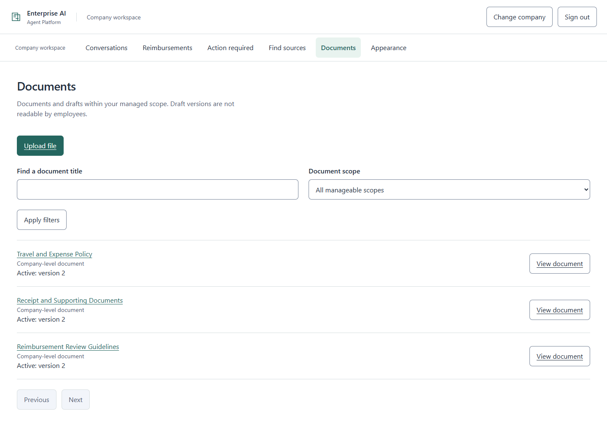
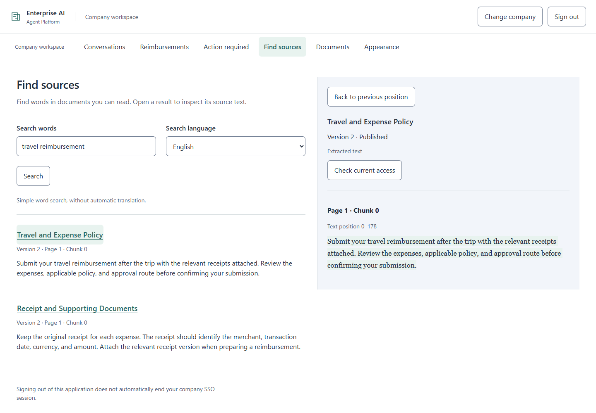

# Product tour

Explore the workspace for policy questions, source inspection, and document management.

## Find a policy and read the source

Search company documents and open a result alongside the source text. The source panel keeps
the document version and passage visible while you read.

## Ask a question and inspect the citation

Conversations connect answers to the supporting policy. Open a citation to read the passage
without leaving the conversation.

## Manage company documents

The document workspace brings uploads, active versions, and publication controls together.
Open a document to inspect its content and manage its lifecycle.

## Light appearance

The workspace also supports a light appearance, with the same source inspection layout.

[Back to project](../../README.md) | [Architecture](../../ARCHITECTURE.md)
